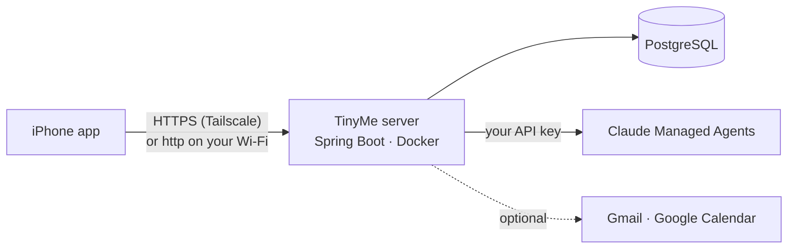

# How to run TinyMe

This guide takes you from a fresh clone to TinyMe running on your own iPhone, backed by your own server. Every step says what it does and why, so you can adapt it to your setup.

TinyMe has three parts:



- **The server** (`server/`) is a Java service. It keeps all your data in PostgreSQL, runs the tools the agent calls, and talks to Anthropic and (optionally) Google with credentials that never leave it.
- **The iPhone app** (`ios/`) talks only to your server.
- **Claude Managed Agents** does the understanding. The server creates the agents it needs on first start, using your Anthropic API key.

You can run everything on your Mac first, then move the server to an always-on machine when you're happy with it. Part A to C get you a working app; D and E are optional.

---

## Contents

- [What you need](#what-you-need)
- [Part A: Run the server on your Mac](#part-a-run-the-server-on-your-mac)
- [Part B: Install the iPhone app](#part-b-install-the-iphone-app)
- [Part C: Reach your server from anywhere (Tailscale)](#part-c-reach-your-server-from-anywhere-tailscale)
- [Part D: Connect Google (optional)](#part-d-connect-google-optional)
- [Part E: Run the server on an always-on machine (optional)](#part-e-run-the-server-on-an-always-on-machine-optional)
- [Settings reference](#settings-reference)
- [Running the tests](#running-the-tests)
- [Troubleshooting](#troubleshooting)
- [Security checklist](#security-checklist)

---

## What you need

| Thing | Why | Cost |
|---|---|---|
| A Mac with **Xcode 26** or later | builds and installs the iPhone app. The app runs on iOS 18+, but uses iOS 26's glass effects where available, so it needs the iOS 26 SDK to build | free |
| An **iPhone** on iOS 18 or later | runs the app | — |
| An **Apple ID** | signs the app for your phone. A free account works; see [free vs paid](#free-or-paid-apple-developer-account) | free, or $99/year |
| **Docker Desktop** (or Docker Engine) | runs PostgreSQL, the full server, and the test database | free |
| **JDK 25** | builds and runs the server outside Docker | free |
| An **Anthropic API key** with access to **Managed Agents** | the agents that understand what you say | pay per use |
| **Tailscale** (optional, recommended) | reach your server from anywhere over HTTPS without opening ports | free for personal use |
| A **Google Cloud project** (optional) | Gmail, Google Calendar and G Scan | free |

Check your tools:

```sh
java -version        # 25 or later
docker --version     # any recent version
xcodebuild -version  # Xcode 26 or later
```

Get the code:

```sh
git clone https://github.com/<you>/tinyme.git
cd tinyme
```

---

## Part A: Run the server on your Mac

### A1. Create your settings file

All server settings live in one file, `.env`, in the repository root. It's ignored by Git, so your secrets never get committed.

```sh
cp .env.example .env
```

Open `.env` and set at least these:

| Setting | What to put | Why |
|---|---|---|
| `ANTHROPIC_API_KEY` | your key from console.anthropic.com | the server uses it to create and talk to the agents |
| `TINYME_OWNER_EMAIL` | the email you'll sign in with | TinyMe has one owner; this account is created on first start |
| `TINYME_OWNER_PASSWORD` | a password of **12 or more characters** | shorter ones are refused and the server won't start |
| `POSTGRES_PASSWORD` | anything long and random | the default `tinyme` is only for a laptop nobody else can reach |
| `TINYME_BLOBS_PATH` | `./blobs` when running from IntelliJ or Maven; `/app/blobs` in Docker | where photos you send are stored |

Leave the `ANTHROPIC_*_ID` lines empty on a first install: the server creates those resources itself (see [A4](#a4-what-happens-on-first-start)). Leave the Google lines empty until [Part D](#part-d-connect-google-optional).

> **Change the database password before the first start.** PostgreSQL stores it when its data volume is created. Changing `POSTGRES_PASSWORD` later doesn't change the stored one.

### A2. Start the database

PostgreSQL runs in Docker. The second compose file publishes its port on `localhost` only, so the server on your Mac can reach it and nothing on your network can:

```sh
docker compose --env-file .env \
  -f deploy/docker-compose.yml \
  -f deploy/docker-compose.dev.yml up -d postgres
```

The image is `pgvector/pgvector`, PostgreSQL with the vector extension TinyMe uses. Data is kept in the Docker volume `postgres_data`, so stopping or rebuilding the container keeps it.

### A3. Start the server

Pick one:

- **IntelliJ IDEA:** open the `server/` folder as a Maven project and run `TinymeApplication`. It reads the repository-root `.env` automatically.
- **Terminal:**

  ```sh
  cd server
  ./mvnw spring-boot:run
  ```

  The Maven wrapper downloads Maven itself the first time; nothing else to install.

- **Everything in Docker** (no JDK needed): set `TINYME_BLOBS_PATH=/app/blobs` in `.env`, then from the repository root:

  ```sh
  docker compose --env-file .env -f deploy/docker-compose.yml up --build -d
  ```

The server listens on port **8080**.

### A4. What happens on first start

You don't need to do anything here, but it helps to know what the server does:

1. **Database migrations** (Flyway) create every table. Each later version adds its own migrations, applied automatically on start.
2. **Your owner account** is created from `TINYME_OWNER_EMAIL` and `TINYME_OWNER_PASSWORD`. After that the account lives in the database; changing `.env` later doesn't change your password.
3. **Agent setup** creates, in your Anthropic account: an environment, the chat agent, and a memory store (where the agent keeps what it learns about you). Their IDs are saved in the database's `settings` table. On every later start the server compares the agent definitions in `server/src/main/resources/seed/agents/` with what's in Anthropic and publishes a new version only when something changed.
4. **Seeding:** the built-in Journal card and the Apple Health entry kinds.

> **Keep the `settings` table.** It holds the IDs of your agents and memory store. Lose it and the next start creates new ones, and the agent forgets what it knew about you. If you move servers, move the whole database ([E3](#e3-move-your-data)).

### A5. Check it's running

```sh
curl http://localhost:8080/actuator/health
# {"groups":["liveness","readiness"],"status":"UP"}
```

If it doesn't start, the error is in the server log; the common ones are in [Troubleshooting](#troubleshooting).

---

## Part B: Install the iPhone app

### B1. Your app settings

The app's per-person settings live in `ios/Config/TinyMe.xcconfig`, also ignored by Git:

```sh
cp ios/Config/TinyMe.xcconfig.template ios/Config/TinyMe.xcconfig
```

| Setting | What to put | Why |
|---|---|---|
| `DEVELOPMENT_TEAM` | your 10-character Apple team ID: Xcode → Settings → Accounts → your Apple ID → Team | signs the app for your phone |
| `PRODUCT_BUNDLE_IDENTIFIER` | leave `com.$(DEVELOPMENT_TEAM).tinyme` | must be unique to you; your team ID makes it so |
| `TINYME_DEFAULT_SERVER_URL` | your server address, if you already know it | pre-fills the sign-in screen. You can type it there instead |
| `TINYME_PUSH_ENABLED` | `NO` unless you have a paid account | push notifications need a paid Apple developer account |

The app and its Home Screen widget share data through the App Group `group.com.<your team>.tinyme`, derived from your team ID automatically.

### B2. Free or paid Apple developer account

Both work. The differences matter day to day:

| | Free Apple ID | Apple Developer Program ($99/year) |
|---|---|---|
| Install from Xcode | ✅ | ✅ |
| How long an install keeps working | **7 days**, then the app stops opening until you install again from Xcode | 1 year |
| Install while away from your Mac (TestFlight) | ❌ | ✅ |
| Push notifications | ❌ (`TINYME_PUSH_ENABLED = NO`) | ✅ |
| Apple Health, location, widget, Siri shortcut | ✅ | ✅ |

### B3. Build and install

1. Connect your iPhone with a cable (or pair it over Wi-Fi in Xcode → Window → Devices and Simulators). On the phone, turn on **Developer Mode** when asked: Settings → Privacy & Security → Developer Mode.
2. Open `ios/TinyMe.xcodeproj` in Xcode.
3. Choose the **TinyMe** scheme and your iPhone as the destination.
4. Press **Run** (⌘R). The first build fetches the app's one Swift package, [Lottie](https://github.com/airbnb/lottie-spm) (for animations), which Xcode does automatically.
5. With a free account, the first launch is blocked until you trust yourself as a developer: on the phone, Settings → General → VPN & Device Management → your Apple ID → **Trust**.

You can also build from the terminal:

```sh
cd ios
xcodebuild -project TinyMe.xcodeproj -scheme TinyMe \
  -destination "id=<your iPhone's UDID>" -allowProvisioningUpdates build
```

### B4. Sign in

Open TinyMe and enter:

- **Server**, one of:
  - `http://<your Mac's local IP>:8080`, for a phone on the same Wi-Fi as your Mac. Plain `http` only works in Debug builds (what Xcode installs), which allow local-network connections. Allow **Local Network** access when iOS asks.
  - `https://<machine>.<tailnet>.ts.net`, once you've set up [Part C](#part-c-reach-your-server-from-anywhere-tailscale). Works anywhere.
- **Email and password**: your `TINYME_OWNER_EMAIL` and `TINYME_OWNER_PASSWORD`.

Each phone gets its own sign-in token, which you can revoke on the server.

### B5. Permissions

iOS asks for each one the first time it's needed, never up front:

| Permission | Asked when | Used for |
|---|---|---|
| Microphone and speech recognition | you first hold the mic button | talking instead of typing; speech is turned into text on the phone |
| Location (While Using) | you ask for something "near me" | place search, and your area in chat |
| Location (Always) + notifications | you turn on nearby-place alerts | an alert when you pass a place you saved |
| Apple Health | you connect Health in Settings | reading the Health data types you pick. TinyMe never writes to Health |
| Notifications | the first reminder | reminders and nudges |

---

## Part C: Reach your server from anywhere (Tailscale)

Tailscale puts your Mac (or server) and your iPhone on a private network only your devices can join, and gives the server a real HTTPS address. Nothing is opened to the internet, and the app's Release build gets the HTTPS it requires.

1. Install Tailscale on the server machine and on your iPhone, and sign in to the same account on both.
2. In the Tailscale admin console, open **DNS** and turn on **MagicDNS** and **HTTPS certificates**.
3. On the server machine, serve the API over HTTPS:

   ```sh
   sudo tailscale serve --bg --https=443 http://127.0.0.1:8080
   ```

   (On a Mac running the Tailscale app, `tailscale serve` works without `sudo`.)
4. Find the address with `tailscale status` or in the admin console. It looks like `https://<machine>.<tailnet>.ts.net`.
5. In the app, sign out (Settings, the gear on Home → Sign out) and sign in with that address.

Keep Tailscale connected on the phone; TinyMe can't reach the server without it.

---

## Part D: Connect Google (optional)

This turns on the Gmail and Calendar helpers in chat, two-way calendar sync, and **G Scan**: card payments, plans and job alerts found in your email. The full reference is [`docs/google-setup.md`](docs/google-setup.md); this is the order to do it in.

### D1. Make an encryption key

Google's sign-in token is stored encrypted, with a key only your server has:

```sh
brew tap tink-crypto/tink-tinkey https://github.com/tink-crypto/tink-tinkey && brew install tinkey
TMP="$(mktemp -d)"
tinkey create-keyset --key-template AES256_GCM --out-format json --out "$TMP/keyset.json"
base64 < "$TMP/keyset.json" | tr -d '\n'; echo
rm -r "$TMP"
```

Put the output in `.env` as `TINYME_ENCRYPTION_KEY=…` and **back it up somewhere safe**. Without it the stored Google token can't be read and you'd have to reconnect Google.

### D2. Set up a Google Cloud project

1. At console.cloud.google.com, create a project.
2. **Enable both APIs** (APIs & Services → Library): **Gmail API** and **Google Calendar API**. They're separate switches; Calendar sync fails with `api_not_enabled` if only Gmail is on.
3. **OAuth consent screen**: audience **External**, add your Google account as a test user, then **Publish app → In production**. In *Testing* mode Google expires your sign-in every 7 days. Google will warn that the app isn't verified; for your own account choose **Advanced → Go to … (unsafe)**.
4. **Credentials → Create credentials → OAuth client ID → Web application**, with this **Authorized redirect URI**:

   ```text
   https://<machine>.<tailnet>.ts.net/integrations/google/callback
   ```

   Google requires HTTPS here, which is one more reason for [Part C](#part-c-reach-your-server-from-anywhere-tailscale). The address must match exactly.
5. Put the client details in `.env`:

   ```dotenv
   GOOGLE_CLIENT_ID=…
   GOOGLE_CLIENT_SECRET=…
   GOOGLE_REDIRECT_URI=https://<machine>.<tailnet>.ts.net/integrations/google/callback
   ```

6. Restart the server.

### D3. Connect from the app

In the app: **Settings → Google → Connect Google**, sign in, and allow Gmail and Calendar. The server then creates three more agents in your Anthropic account (Gmail helper, Calendar helper, mail scanner) and gives the chat agent access to the first two.

What happens next:

- **Calendar sync** runs every 5 minutes: your plans appear in a calendar called "TinyMe" in Google, and events from your other Google calendars appear in Upcoming.
- **The mail scan** runs every 15 minutes. It first looks back 7 days, then reads only new mail. Everything it finds waits in **G Scan**; nothing is added without your tap. Card payments count as spending only once you confirm them.
- **Sending email or answering an invite** always waits for your tap.

> **Moved your server?** The redirect URI changes with it: update `GOOGLE_REDIRECT_URI` **and** the address in the Google Cloud client.

---

## Part E: Run the server on an always-on machine (optional)

Your Mac sleeps, and the app needs the server whenever you use it: chat, background Health syncs, reminders. Any always-on Linux machine works. Below uses Ubuntu 24.04 with Docker and Tailscale.

### E1. Choose a machine

| Option | Cost | Notes |
|---|---|---|
| Oracle Cloud Always Free, Ampere A1 (up to 2 CPUs / 12 GB) | free, ongoing | the best free option, but "Out of capacity" is common in busy regions; you may wait days |
| AWS EC2 free plan, `t4g.small` (2 GB) | free for 6 months from credits, then about $15–20/month | starts immediately; add a 2 GB swap file |
| A spare computer at home | free | depends on your home power and internet |
| Render's free tier | — | not suitable: the free database is deleted after 30 days, files are wiped on restart, and the service sleeps |

TinyMe needs about 1–1.5 GB of memory for Java and PostgreSQL together, and very little disk (a year of use is well under 1 GB).

### E2. Set up the machine

On the new machine (as a normal user with `sudo`):

```sh
# Security updates, installed automatically from now on
sudo apt-get update && sudo apt-get -y upgrade
sudo apt-get install -y unattended-upgrades && sudo dpkg-reconfigure -f noninteractive unattended-upgrades

# A swap file, on machines with less than 4 GB of memory
sudo fallocate -l 2G /swapfile && sudo chmod 600 /swapfile && sudo mkswap /swapfile && sudo swapon /swapfile
echo '/swapfile none swap sw 0 0' | sudo tee -a /etc/fstab

# Docker
curl -fsSL https://get.docker.com | sudo sh
sudo usermod -aG docker "$USER"     # log out and back in afterwards

# Tailscale, with HTTPS for the API (Part C)
curl -fsSL https://tailscale.com/install.sh | sudo sh
sudo tailscale up --ssh --hostname tinyme
sudo tailscale serve --bg --https=443 http://127.0.0.1:8080
```

Copy the code and your `.env` to the machine (for example with `git clone`, then `scp .env <machine>:tinyme/.env`). On the server, set `TINYME_BLOBS_PATH=/app/blobs` in `.env`.

Start it with both compose files. The second one (`deploy/docker-compose.server.yml`) publishes the API on `127.0.0.1` only, so it's reachable through Tailscale and not from the internet. It also hands the API your whole `.env`, rotates logs and sizes Java's memory:

```sh
cd ~/tinyme
docker compose --env-file .env -f deploy/docker-compose.yml -f deploy/docker-compose.server.yml up -d --build
curl http://127.0.0.1:8080/actuator/health
```

Once Tailscale SSH works (`ssh <user>@tinyme`), close the machine's public SSH port in your cloud provider's firewall. Then nothing on it is open to the internet.

### E3. Move your data

Moving keeps everything, including the agent and memory-store IDs in `settings`. **Stop the old server first**, so nothing changes during the copy, and keep it stopped afterwards, or the two copies drift apart.

On the old machine, dump the database and pack the photos:

```sh
docker exec <postgres container> sh -c 'pg_dump -U "$POSTGRES_USER" -d "$POSTGRES_DB" -Fc' > tinyme.dump
tar -C blobs -czf blobs.tgz .        # or wherever TINYME_BLOBS_PATH points
scp tinyme.dump blobs.tgz <user>@<new machine>:
```

On the new machine, with the stack built but the API stopped:

```sh
cd ~/tinyme
c="docker compose --env-file .env -f deploy/docker-compose.yml -f deploy/docker-compose.server.yml"
$c stop api
$c exec -T postgres sh -c 'dropdb -U "$POSTGRES_USER" --if-exists -f "$POSTGRES_DB" && createdb -U "$POSTGRES_USER" "$POSTGRES_DB"' </dev/null
$c exec -T postgres sh -c 'pg_restore -U "$POSTGRES_USER" -d "$POSTGRES_DB" --no-owner --exit-on-error' < ~/tinyme.dump
$c run --rm -T --no-deps --entrypoint sh api -c 'tar -C /app/blobs -xzf -' < ~/blobs.tgz
$c up -d api
```

> The `</dev/null` matters when you put these lines in a script fed over `ssh … bash -s`: without it, `docker compose exec` reads the rest of the script as its own input and the later steps silently never run.

Then sign in to the app with the new server's address, and update Google's redirect URI ([Part D](#part-d-connect-google-optional)).

### E4. Back up every night

A nightly dump of the database and photos, keeping 14 days. Add to the server's crontab (`crontab -e`):

```cron
30 3 * * * cd ~/tinyme && mkdir -p ~/backups && docker compose --env-file .env -f deploy/docker-compose.yml -f deploy/docker-compose.server.yml exec -T postgres sh -c 'pg_dump -U "$POSTGRES_USER" -d "$POSTGRES_DB" -Fc' > ~/backups/db-$(date +\%F).dump && find ~/backups -name 'db-*.dump' -mtime +14 -delete
```

Backups on the same machine protect against mistakes, not against losing the machine. Copy the newest ones elsewhere now and then:

```sh
rsync -av <user>@tinyme:backups/ ~/TinyMe-backups/
```

To restore a dump, use the same commands as [E3](#e3-move-your-data).

### E5. Update

```sh
cd ~/tinyme && git pull
docker compose --env-file .env -f deploy/docker-compose.yml -f deploy/docker-compose.server.yml up -d --build
```

New migrations run on start, and changed agent definitions are published as new agent versions.

---

## Settings reference

All of these go in `.env`. Only the first block is required.

| Setting | Default | What it does |
|---|---|---|
| `ANTHROPIC_API_KEY` | — | **Required.** Your Anthropic key, used for all agent calls |
| `TINYME_OWNER_EMAIL` / `TINYME_OWNER_PASSWORD` | — | **Required on first start.** Creates the one owner account; password 12–256 characters |
| `POSTGRES_DB` / `POSTGRES_USER` / `POSTGRES_PASSWORD` | `tinyme` | Database name, user and password. Set the password before the first start |
| `TINYME_BLOBS_PATH` | `./blobs` | Where photos are stored. `/app/blobs` in Docker |
| `API_PORT` | `8080` | The host port in the plain Docker setup |
| `TINYME_AGENT_SETUP_ENABLED` | `true` | Create and update the agents on start. Leave on |
| `TINYME_ALLOW_NEW_MEMORY_STORE` | `false` | If the memory store is missing, `true` makes a new, empty one instead of refusing to start. Old memories aren't recovered |
| `ANTHROPIC_ENVIRONMENT_ID`, `ANTHROPIC_AGENT_ID`, `ANTHROPIC_MEMORY_STORE_ID` | empty | Only to adopt existing resources on a fresh database. IDs already in the database win |
| `TINYME_ENCRYPTION_KEY` | empty | Tink keyset that encrypts the Google token. Needed for Google |
| `GOOGLE_CLIENT_ID` / `GOOGLE_CLIENT_SECRET` / `GOOGLE_REDIRECT_URI` | empty | Your Google OAuth client ([Part D](#part-d-connect-google-optional)) |
| `TINYME_MAILSCAN_INTERVAL` | `15m` | How often the mail scan runs (it also runs when you open the app) |
| `TINYME_MAILSCAN_MAX_PER_RUN` / `TINYME_MAILSCAN_MAX_PER_DAY` | `30` / `200` | Caps on how many emails are read, to bound cost |

Settings you change in the app, not `.env`: your **currency** (Settings → Money; the first launch takes your phone region's), Apple Health groups, appearance and voice.

---

## Running the tests

**Server** (needs Docker, for the Testcontainers database):

```sh
cd server
./mvnw verify
```

The tests never call Anthropic or Google: they use recorded streams and fakes.

**iPhone app** (in the simulator):

```sh
cd ios
xcodebuild test -project TinyMe.xcodeproj -scheme TinyMe \
  -destination "platform=iOS Simulator,name=iPhone 17 Pro"
```

Use any simulator you have installed (`xcrun simctl list devices`).

---

## Troubleshooting

| What you see | Why | Fix |
|---|---|---|
| Server stops with *"No owner account exists. Set TINYME_OWNER_EMAIL and TINYME_OWNER_PASSWORD"* | first start without those settings, or (in Docker) the API container doesn't receive them | set both in `.env`. On a server, start with `deploy/docker-compose.server.yml`, which passes the whole `.env` to the container |
| Server refuses to start: owner password | shorter than 12 characters | use 12 or more |
| *"Memory store not found or archived"* | the store saved in `settings` was deleted in Anthropic | restore it, or set `TINYME_ALLOW_NEW_MEMORY_STORE=true` once (starts empty) |
| App can't connect over Wi-Fi | wrong IP, Local Network access denied, or a Release build (no plain `http`) | check the Mac's IP; Settings → TinyMe → Local Network; or use Tailscale HTTPS |
| App can't connect away from home | Tailscale off on the phone | turn Tailscale on |
| TinyMe stopped opening after a week | free Apple account installs last 7 days | install again from Xcode, or join the Developer Program |
| Location never works, no permission prompt | the location permission text is missing from the Info.plist your build uses | both `ios/Config/Info.plist` and `Info-Debug.plist` must contain `NSLocationWhenInUseUsageDescription` |
| Chat shows *"waiting on responses to events [sevt_…]"* | the server restarted while a tool was running | send the message again: TinyMe answers the stuck call and carries on |
| Chat shows *"session not found"* | today's chat session was deleted in the Anthropic console | send again: TinyMe starts a fresh session for the day |
| Google sign-in fails with *redirect_uri_mismatch* | the redirect URI in Google Cloud and `GOOGLE_REDIRECT_URI` differ | make them identical, including `https://` and the path |
| Google disconnects every week | consent screen still in *Testing* | publish it: **In production** |
| Calendar sync: `scope_missing` | connected before Calendar was requested | Settings → Google → Reconnect, and allow Calendar |
| Calendar sync: `api_not_enabled` | Google Calendar API is off in the Cloud project | enable it (APIs & Services → Library) |
| Card emails don't appear in G Scan | Gmail put them in the Promotions tab, which the scan skips | move one to Primary (Gmail learns), and check after the next scan |
| Mail scan says `daily_limit` | 200 emails already read today | wait until midnight in your time zone, or raise `TINYME_MAILSCAN_MAX_PER_DAY` |
| Oracle: "Out of capacity for shape VM.Standard.A1.Flex" | no free Ampere machines in your region right now | try a smaller size, another availability domain, or later; or use another provider |

The server log has the details: `docker compose … logs -f api` in Docker, or the Run window in IntelliJ.

---

## Security checklist

- **Never commit `.env` or `ios/Config/TinyMe.xcconfig`.** Both are in `.gitignore`. If a secret ever lands in a commit, rotate it: removing it from the latest commit doesn't remove it from history.
- **Use a long owner password and change `POSTGRES_PASSWORD`** before the first start of any server other people could reach.
- **Back up `TINYME_ENCRYPTION_KEY`** separately from the database. Without it the stored Google token can't be read.
- **Don't open ports to the internet.** With Tailscale, the API listens only on `127.0.0.1` and only your devices can reach it. Close public SSH once Tailscale SSH works.
- **Know what leaves your server:** messages and the context needed to answer them go to Anthropic. With Google connected, emails the Gmail helper reads and the trimmed emails the scanner checks also go to Anthropic. Email bodies are not stored in TinyMe's database. Speech is turned into text on the phone.
- **Keep the machine updated:** unattended upgrades on the server, and `git pull` + rebuild for TinyMe.
