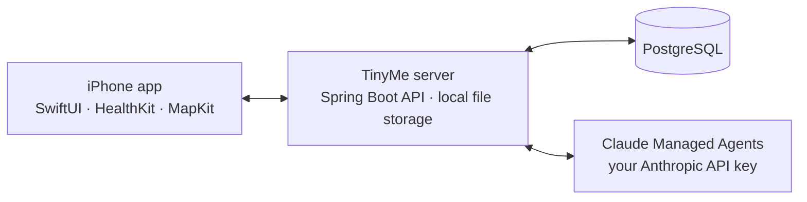

<div align="center">

# TinyMe

**Your life, logged by talking.**

A self-hosted personal assistant for iPhone, backed by your own server.

[](LICENSE)


-161A23.svg)

<br/>

&nbsp;
&nbsp;


</div>

---

## What TinyMe does

Talk or type naturally, and TinyMe files the request using the right feature. For example, it can log something that happened, remember a fact about a person, save a place, or add a plan. Ask questions about your logs later, or build cards that summarize them.

The iPhone app currently includes:

| Area | Available features |
|---|---|
| **Chat** | Streamed text replies, on-device speech transcription, photo attachments, and an offline message queue that sends when connectivity returns. |
| **Journal and History** | Add, search, aggregate, update, and delete entries. Browse entries by kind and open entry details. |
| **Home cards** | A seeded Journal card plus cards created in chat. Cards support statistics, progress, charts, goals, check-ins, breakdowns, and latest-entry blocks. Day, week, month, and year ranges are supported. |
| **People and photos** | Keep people profiles and memory, attach an image from chat to a person when you identify them, and browse a person's saved photos. |
| **Places** | Search and save places from chat, browse them in a list or map, add notes, mark them visited, and remove them. Optional nearby alerts use on-device location monitoring and local notifications. |
| **Upcoming** | View plans in a day calendar, including timed events, all-day items, tasks, and repeating plans. Create and change plans in chat and use calendar actions for occurrences. |
| **Apple Health** | Select supported Health data types and sync their entries to your TinyMe server. Health access and syncing are controlled in Settings. |
| **Quick access** | A Home Screen widget and a Journal shortcut for Shortcuts, Siri, and Back Tap. |
| **Account and data** | Email-and-password sign-in, per-device revocable tokens, ZIP export, and delete-all controls. |

## How it works



The agent interprets a request and calls a tool. The server validates and executes that tool, stores the result, and streams the reply to the app. Entry totals, trends, and card values are computed by the backend from PostgreSQL.

TinyMe stores account data in PostgreSQL and uploaded image content in the server's configured local blob directory. Agent requests and responses are processed through Anthropic using the API key configured on the server. Speech recognition is performed on the iPhone before the transcript is sent.

## Requirements

- JDK 25
- Docker, for PostgreSQL and the Testcontainers test suite
- An Anthropic API key with access to Managed Agents
- For the iPhone app: macOS, Xcode, and an iPhone running iOS 18 or later

## Run the server locally

From the repository root, configure the environment:

```sh
cp .env.example .env
```

Set `ANTHROPIC_API_KEY`, `TINYME_OWNER_EMAIL`, and `TINYME_OWNER_PASSWORD` in `.env`. The owner account is created on first boot; choose a password of at least 12 characters. The `.env` file is ignored by Git.

Start PostgreSQL and the API:

```sh
docker compose --env-file .env \
  -f deploy/docker-compose.yml \
  -f deploy/docker-compose.dev.yml up -d postgres

cd server
./mvnw spring-boot:run
```

The API listens on port 8080. On startup, the server applies Flyway migrations and reconciles the seeded agent and environment. To run the full Docker deployment instead, see [`deploy/README.md`](deploy/README.md).

For IntelliJ, start PostgreSQL with the command above and run `TinymeApplication`. The application reads the repository-root `.env`; for a local file directory, set `TINYME_BLOBS_PATH=./blobs`.

Run backend tests from `server/`:

```sh
./mvnw verify
```

`verify` includes Testcontainers tests and requires Docker to be available.

## Run the iPhone app

1. Copy `ios/Config/TinyMe.xcconfig.template` to `ios/Config/TinyMe.xcconfig` and set your Apple development team ID.
2. Open `ios/TinyMe.xcodeproj` in Xcode, select your iPhone, and run the `TinyMe` scheme.
3. Sign in with the server URL and owner credentials configured in `.env`.

For a phone on the same Wi-Fi network, use `http://<your-mac-ip>:8080` with a Debug build and allow local network access when prompted. A server reached over the internet needs an HTTPS URL.

Location alerts need location access and notification permission. Apple Health sync needs the user to grant access to the selected Health data types.

## Repository layout

```text
tinyme/
├── server/       Spring Boot API, agent tools, domain code, migrations, and tests
├── ios/          SwiftUI app, HealthKit sync, device tools, and widget
├── deploy/       Docker Compose deployment files
└── docs/images/  Screenshots used in this README
```

TinyMe is MIT licensed. It is an independent project and is not affiliated with Anthropic or Apple.
