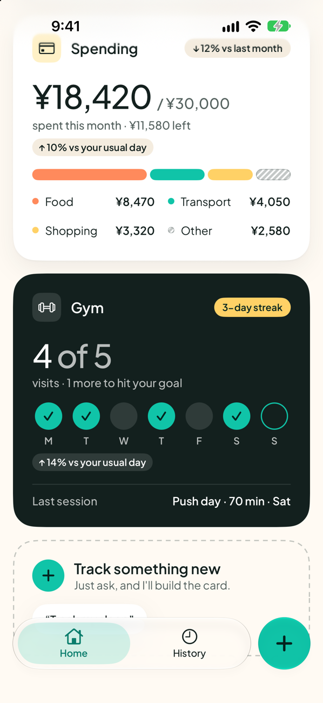
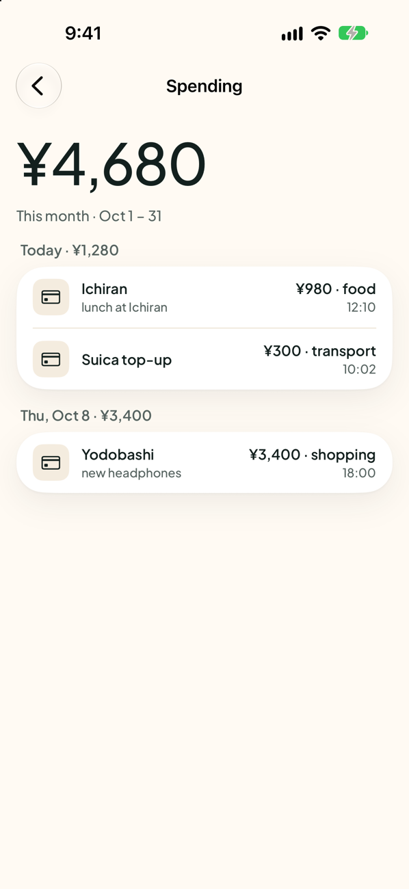
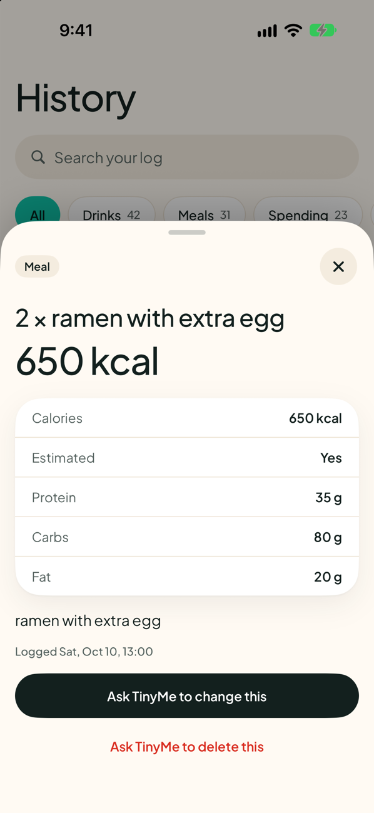
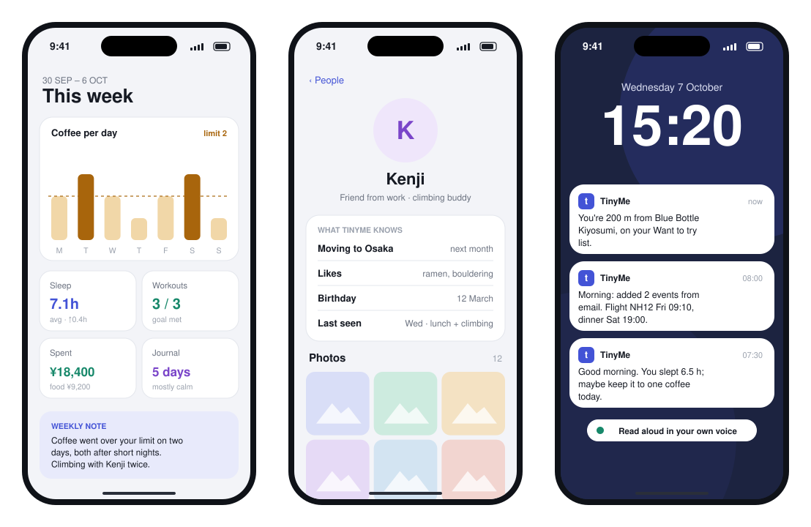
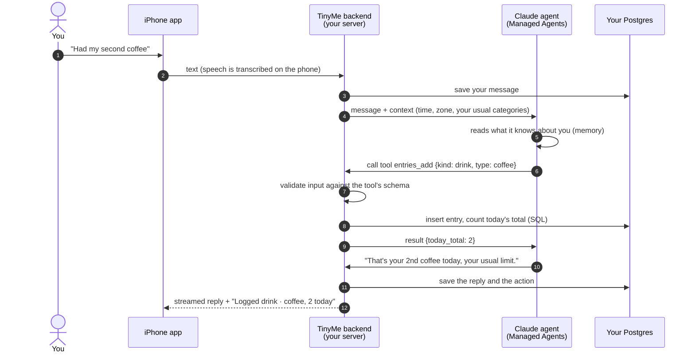
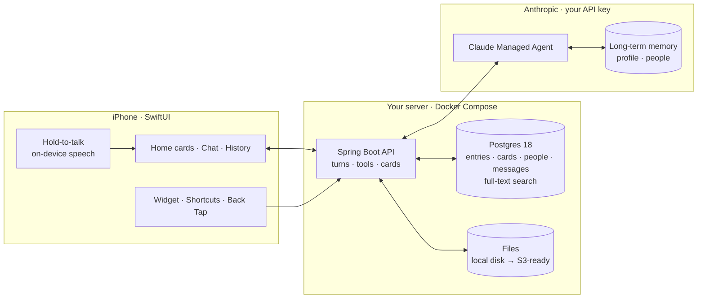

<div align="center">

# TinyMe

**Your life, logged by talking.**
A private, voice-first personal agent for iPhone that you run on your own server.

[](LICENSE)


-161A23.svg)

<br/>

&nbsp;
&nbsp;


<sub>The iPhone app as it runs today, shown with sample data: Home, chat, and History.</sub>

</div>

---

## The idea

You already produce a stream of small facts about your life: the second coffee, the friend who's moving to Osaka, the ramen place you want to try, ¥1,200 for lunch, a good day or a bad one.

Keeping track of them means a different app for each thing, a form for every entry, and a category for every thought. So almost nobody keeps it up.

**TinyMe works the other way round. You just talk:**

> *"Had my second coffee. Kenji's moving to Osaka next month, remember that. Remind me to call mom tomorrow at 8."*

TinyMe works out that this is **a log, a fact about a person, and a reminder**, and files each one in the right place. You never pick a category or fill in a field. Later you ask your own life questions:

> *"When did I last go climbing?"* · *"How much did I spend on food this month?"* · *"What do I know about Kenji?"*

…and get answers built from **your own records**, with the dates they came from.

---

## The app today

<div align="center">
&nbsp;
&nbsp;

</div>

<sub>More of the app with sample data: cards TinyMe built on request, the entries behind a card, and one entry in detail.</sub>

| Screen | What it does |
|---|---|
| **Home** | A stack of cards, each one a tracker. Journal is always first; the rest are cards you asked for in chat. A Day / Week / Month / Year switcher changes them together. Long-press a card to remove it, drag to reorder. |
| **Cards** | The server describes each card as blocks, and the app draws them: a big number, a ring or half-circle gauge against a goal, goal bars, a bar chart, visit dots, a category split, and the latest entry. Tap a bar to read its value. The corner shows how you compare with last time or with your usual day. |
| **Chat** | Type or hold the mic. Replies stream in as they are written, with a chip for everything TinyMe did ("Logged drink · 2 today"). When it builds a card, a live preview appears under the reply with **Add to Home** and **Change goal**. |
| **Voice** | Hold to talk. Speech is turned into text on the phone and never leaves it. The words stay editable, or send themselves when you let go if you turn that on. |
| **History** | Everything you've logged, newest first, with search and a chip per kind. |
| **Drill-down** | Tap a card, or one category, bar or dot of it, to see exactly the entries behind that number. The server builds the filter from the card, so the list always adds up to what the card says. |
| **Entry detail** | Every field of one entry, with "Ask TinyMe to change this" and "Ask TinyMe to delete this", which open chat with the sentence already written. |
| **Outside the app** | A home-screen widget with a "Journal something?" shortcut and your stats in rotation, and a "Journal something" action for Shortcuts, Siri and Back Tap that logs without opening the app. |
| **Settings** | Your server, sign out, light / dark / automatic appearance. |

---

## What makes it different

| | |
|---|---|
| 🎙️ **Zero forms** | Voice first. A single sentence can hold several things to file, and each one is handled. New kinds of logs ("piano practice", "headache", "plants watered") need no code: the agent invents the category and reuses it consistently. |
| 🃏 **Trackers on request** | "Make me a spending card with a ¥30,000 budget." The agent writes a small card definition; the server works out the numbers; the app draws it. No screen is hard-coded to one kind of data. |
| 🔒 **Your data, your server** | Everything lives in **your own Postgres database** on a machine you control. You bring your own API key. Full export and delete-everything are part of the design. |
| 🔢 **Honest numbers** | The model decides *what* to do; code does it. Every count, total and trend comes from a SQL query, never from the model's guess. "No record of that" is a valid answer; "you never did that" is not. |
| 🧠 **Remembers like a friend** | Durable facts about you and the people in your life (preferences, routines, birthdays, life events) are kept in long-term agent memory and used naturally in later conversations. |
| 🛡️ **Safe by default** | Anything with outside effects (sending email, accepting invites, deleting data) needs your tap to confirm. Email content is treated as data, never as instructions. People in photos are only ever known from your own tags; there's no face recognition. |
| 🧩 **Open source, modular** | MIT-licensed. Gmail, Calendar, Places and voice are separate modules you can switch off; the core works without Google at all. |

---

## What it does, and what's coming



<sub>Concept designs for parts that aren't built yet: a person's profile and proactive notifications.</sub>

| Capability | Example | Status |
|---|---|---|
| **Log anything** | "Had a latte" · "Slept 6.5 hours" · "Journal: long day, but the demo went well" | ✅ Working, from the app |
| **Ask your history** | "When did I last go climbing?" · "How many coffees this week?" | ✅ Working, from the app |
| **Change and delete** | "That lunch was ¥980, not ¥890" · "Delete this morning's coffee" | ✅ Working, through chat |
| **Trackers on Home** | "Track my calories against 2,200 a day" · "Show spending by category" | ✅ Working |
| **Trends** | Change against last week or month, and against your usual day | ✅ Working |
| **History and drill-down** | Browse and search every entry; tap a card to see what's behind it | ✅ Working |
| **Voice** | Hold to talk, transcribed on the phone | ✅ Built · being tested |
| **Widget and shortcut** | Home-screen widget; log from Back Tap or Siri without opening the app | ✅ Built · being tested |
| **People** | "Kenji is my friend from work, he likes ramen" | 🛠️ Works in chat · no screen yet |
| **Photos** | "This is Kenji at Kamakura" → find it later by person, place or date | 🗺️ Later in Phase 1 |
| **Offline** | Messages queue on the phone and send when you're back online | 🗺️ Later in Phase 1 |
| **Email → Calendar** | Flights, bookings and invites found in Gmail land on a "TinyMe" calendar every morning, without duplicates | 🗺️ Phase 2 |
| **Reminders & goals** | "Remind me to call mom at 8" · "Run 3× a week" with progress nudges | 🗺️ Phase 3 |
| **Receipts & reports** | Receipt photos, weekly and monthly summaries | 🗺️ Phase 4 |
| **Saved places nearby** | "You're 200 m from Blue Bottle Kiyosumi, on your Want to try list" | 🗺️ Phase 5 |
| **Your own voice** | Notifications played in short clips you recorded yourself | 🗺️ Phase 6 |

---

## How it works



**The core rule: the model decides, your code acts.**

- The agent chooses *what* should happen ("this is a drink log").
- Your backend checks the request against a strict schema, runs it, and stores the result.
- Each tool call is recorded with a unique event ID, so a repeated event after a network drop **never logs your coffee twice**.
- Any failure becomes an error the agent can read and explain to you. A broken tool never leaves you without an answer.

**Cards follow the same rule.** The agent only writes a card's *definition*: which entries, which period, which goal, which kind of block. The server evaluates it with SQL every time Home loads, and the app draws whatever blocks come back. The agent never writes a number onto a card.

---

## Architecture



| Layer | Choice | Why |
|---|---|---|
| Agent | **Claude Managed Agents** | Hosted agent loop with sessions, long-term memory stores and custom tools, so the backend only implements the tools |
| Backend | **Java 25 · Spring Boot 4.1 · Maven** | Typed, testable, and boring in the best way. Virtual threads for long agent turns |
| Database | **Postgres 18** · JSONB · full-text search · trigram · earthdistance · Flyway | One generic `entries` table the agent can fill with any kind of log; numbers come from SQL |
| Storage | Local disk with **S3-ready rules** | Start simple; move to S3, R2 or MinIO-compatible storage without changing the app |
| Client | **SwiftUI · Swift 6 · iOS 18+**, no third-party dependencies, sideloaded from Xcode | A thin client: the server sends data, the app formats and draws it. No App Store needed |
| Quality | JUnit · Testcontainers (real Postgres) · GitHub Actions | Every repository is tested against a real database |

---

## Where it stands today

The **core loop works end to end on a real phone**: say or type something, watch it get filed, see it on Home, and find it again in History.

**Backend**

- ✅ **Agent provisioning on startup.** The agent, environment and memory store are created or updated from versioned YAML in the repo, and are never duplicated. Your memory is never silently replaced.
- ✅ **Tool framework.** Schema validation, run-once guarantees per event, and errors as readable results.
- ✅ **Ten tools.** Entries: add, query, aggregate, update, delete. People: get, upsert. Cards: list, save, delete.
- ✅ **Turn loop.** One session per day, a context block per message, streamed events, tool calls answered live, and a hard timeout with clean cancellation.
- ✅ **App API.** Sign-in with a revocable device token, chat over server-sent events, cards for a chosen range, the entries behind a card, the full entry log with search, and kinds.
- ✅ **Card engine.** Seven block types evaluated from a stored definition, with comparisons against the previous period and against your usual day.
- ✅ **Over 300 automated tests**, including real Postgres via Testcontainers.

**iPhone app**

- ✅ Sign-in to your own server, kept in the Keychain.
- ✅ Home, chat, History, drill-down and entry detail, as shown above.
- ✅ Voice input, the widget and the shortcut are built and in first testing on a device.
- ✅ Light and dark.
- 🛠️ **No automated tests yet.** So far the app is checked by hand and against a stand-in server.
- 🛠️ Not built: offline queue, photos, People screen, reminders, and the Upcoming tab.

### Roadmap

| Phase | Goal | Done when |
|---|---|---|
| **1. Core backend** | Talk → log → recall | Logging, counting, searching and people all work end to end |
| **1b. iPhone app** *(now)* | The same, by voice, on the phone | Used daily for two weeks without opening the database |
| **2. Google** | Gmail → Calendar every morning | A week of real email creates correct events with no duplicates |
| **3. Actions & goals** | Reminders, confirmations, nudges | "Remind me at 8" works even with the phone offline |
| **4. Money & trends** | Receipts, weekly and monthly reports | A monthly report matches the card statement to the yen |
| **5. Places** | "You're near a place you saved" | Walking past a saved cafe triggers exactly one alert |
| **6. Voice & trust** | Own-voice notifications, memory editor, export/delete | You can see, edit and wipe everything TinyMe knows |
| **7. v1.0** | A stranger can install it from this README | A friend sets it up with no help |

---

## Privacy, in plain words

- **Your records stay with you.** Entries, cards, people and messages are stored in your Postgres database and your file storage, on your machine.
- **Your voice stays on your phone.** Speech is turned into text on the device; only the text is sent to your server.
- **Conversations are processed by Claude** through **your own Anthropic API key**. That's how the agent understands you. Its long-term memory lives in a memory store under your account, and you'll be able to read, edit and delete it.
- **Minimum data to the model.** Tools return only what's needed (matching entries or totals), never whole tables.
- **You're in control of outside effects.** Nothing is sent, accepted or deleted on your behalf without a confirmation tap.
- **The widget shows a snapshot.** It displays the stats the app last loaded, shared with it on the phone, and is cleared when you sign out.
- **Planned:** one-tap export of everything, delete-everything (database, files, memory and agent sessions), and automatic clean-up of old sessions.

---

## Cost to run

TinyMe is self-hosted, so there's no subscription. You pay for what you use:

| Item | Rough cost |
|---|---|
| Claude API (normal daily use) | **≈ $5–15 / month**. Measured in development: about $0.05 for the first message of the day (prompt cache warm-up), then about $0.007 per message |
| Server | Any small VPS, home server or spare machine running Docker |
| Apple | Free Apple ID works (re-install every 7 days); the $99/year developer account removes that limit and adds push notifications |

Per-session and monthly budget caps are part of the plan.

---

## Run it yourself (developers)

### 1. The backend

**You need:** JDK 25, Docker, and an [Anthropic API key](https://console.anthropic.com/).

```sh
# Configure
cp .env.example .env              # set ANTHROPIC_API_KEY, and the email and password
                                  # you'll sign in with: TINYME_OWNER_EMAIL, TINYME_OWNER_PASSWORD

# Start Postgres
docker compose --env-file .env -f deploy/docker-compose.yml -f deploy/docker-compose.dev.yml up -d postgres

# Start the server (port 8080)
cd server
./mvnw spring-boot:run
```

On first start, TinyMe creates its agent, environment and memory store on Anthropic and saves their IDs in your database. Every later start only updates what changed.

To try it without the app, send one message from the terminal:

```sh
./mvnw spring-boot:run -Dspring-boot.run.profiles=dev -Dspring-boot.run.arguments="had a coffee"
```

### 2. The iPhone app

**You need:** a Mac with Xcode 26 or later, and an iPhone on iOS 18 or later.

```sh
cd ios
cp Config/TinyMe.xcconfig.template Config/TinyMe.xcconfig    # then set DEVELOPMENT_TEAM to your Apple team ID
open TinyMe.xcodeproj
```

1. In Xcode, pick your iPhone as the destination and press Run. The first time, trust your developer profile on the phone under Settings → General → VPN & Device Management.
2. On the login screen, enter your server's address, and the email and password from `.env`.
   - With the phone on the same network as the server, use `http://<your-mac-ip>:8080`. Type the `http://`: without a scheme the app assumes HTTPS. Debug builds allow plain HTTP on the local network; release builds need HTTPS.
   - Allow the local-network prompt when iOS asks.
3. To add the widget, long-press the home screen → Edit → Add Widget → TinyMe.
4. To log from Back Tap, go to Settings → Accessibility → Touch → Back Tap and choose **Journal something**.

More detail: [`server/README.md`](server/README.md) (package layout, tests, setup) · [`deploy/README.md`](deploy/README.md) (Docker).

```text
tinyme/
├── server/            Spring Boot backend: agent, tools, cards, API, migrations, seeds
├── ios/
│   ├── TinyMe/        The app: Home, Chat, History, Session, and the API client
│   ├── TinyMeWidget/  The home-screen widget
│   ├── TinyMeShared/  Colours, type and the font, used by both
│   └── Config/        Build settings; your own values go in a git-ignored file
├── deploy/            Docker Compose for the backend and Postgres
└── docs/              Images
```

---

## Get involved

TinyMe started as one engineer's attempt to build the assistant he actually wanted: one that remembers, counts honestly, and belongs to its user. It's built in the open, one tested piece at a time.

Support would speed up the parts that turn a working prototype into something people use every day:

- **The iPhone app**: tests, offline use, and the screens that aren't built yet
- **Design**, so logging your life feels lighter than any form
- **A security and privacy review** before the first public release
- **Beta testers**, and API credits for their first months

If that interests you, open an issue or reach out on GitHub: [@bharatekarhade](https://github.com/bharatekarhade).

---

<div align="center">
<sub>MIT License · Built in Tokyo · TinyMe is an independent project and isn't affiliated with Anthropic or Apple.</sub>
</div>
