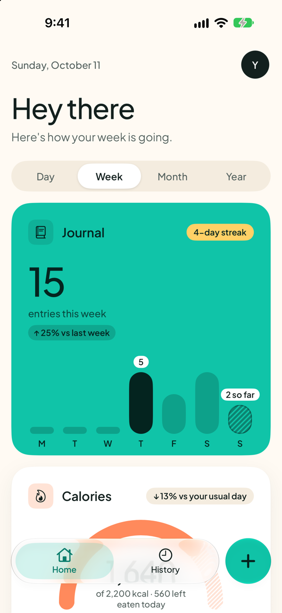
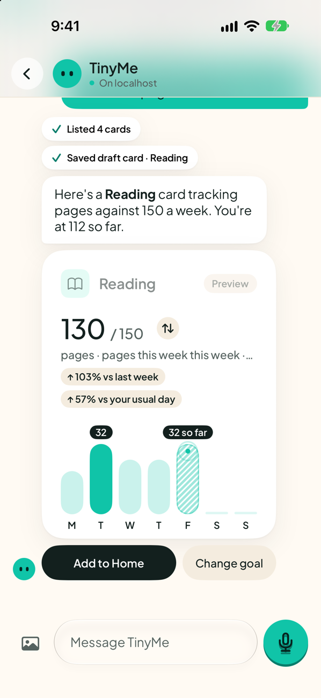
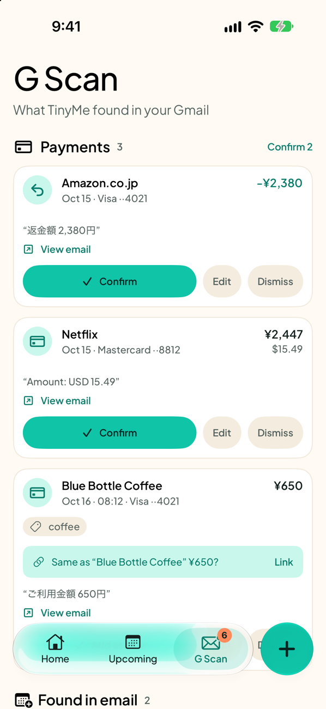
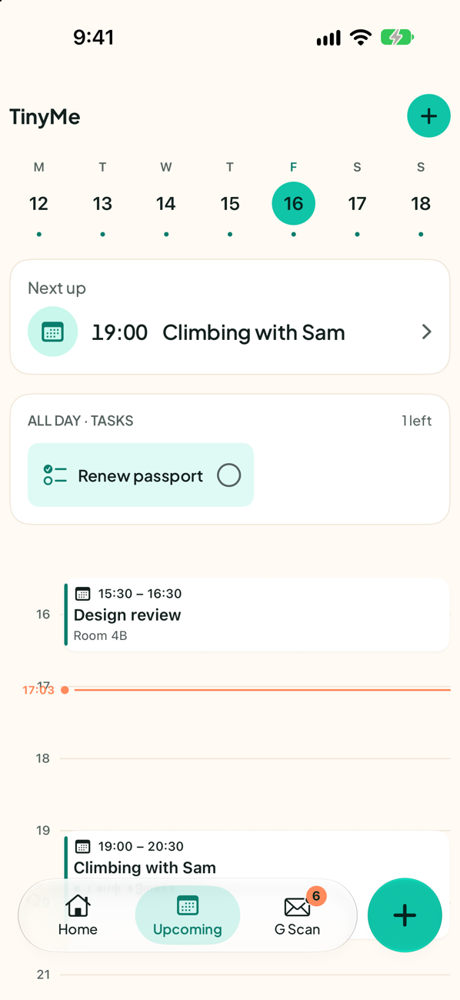
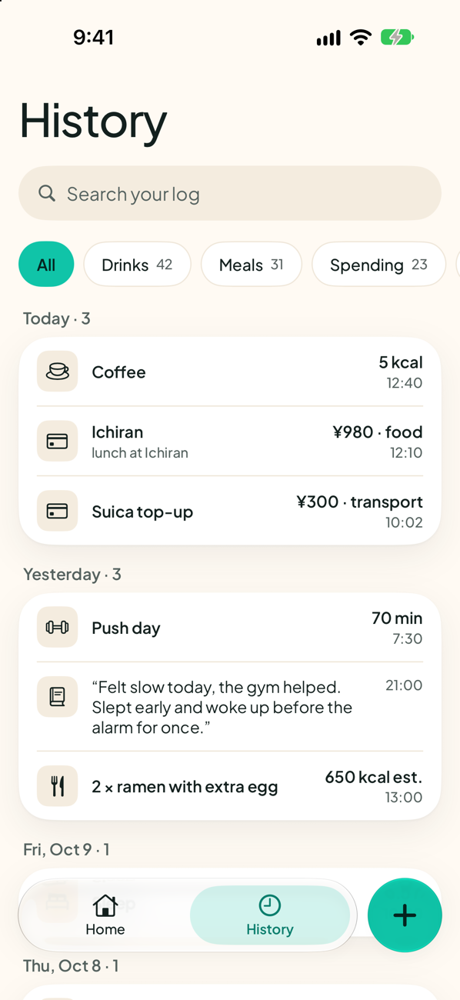
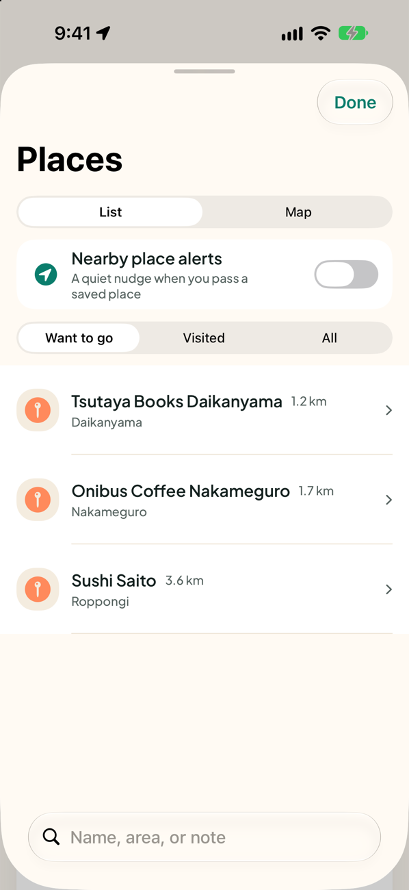
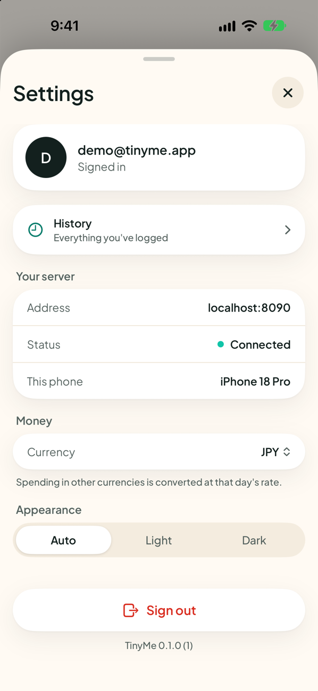
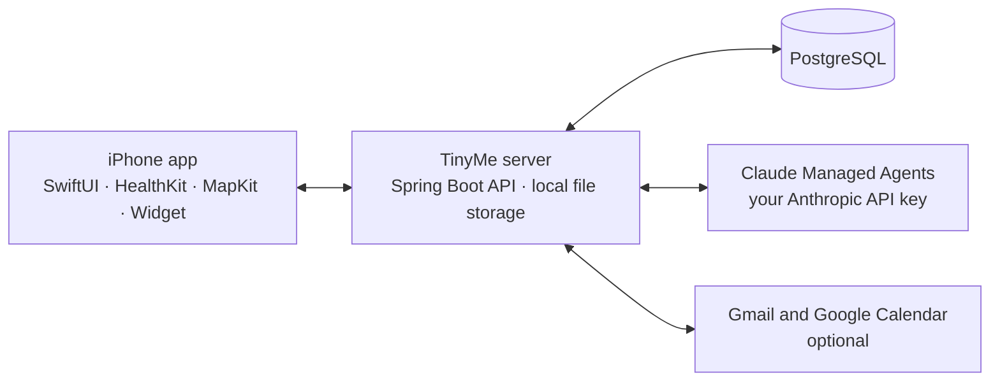

<div align="center">

# TinyMe

**Your life, logged by talking.**

A self-hosted personal assistant for iPhone, backed by your own server.

[](LICENSE)


-161A23.svg)

<br/>

&nbsp;
&nbsp;
&nbsp;


&nbsp;
&nbsp;


<sub>Screenshots use sample data on a local demo server.</sub>

</div>

---

## What TinyMe does

Talk or type naturally, and TinyMe files it in the right place. "Flat white and a salmon onigiri" becomes two entries with calories. "Lunch with Kenji at 12:30, remind me" becomes a plan. "How much did I spend on coffee this month?" gets an answer worked out from your own data. Cards on Home keep the numbers you care about in view, and G Scan brings in what your Gmail already knows.

### Chat

- Streamed replies, with a chip under each reply for everything it did ("Logged meal · Salmon onigiri", "Added event · Lunch with Kenji").
- Voice input, transcribed on the iPhone before anything is sent.
- Photos: attach one, and when you say who is in it, it is saved to that person.
- Cards made in chat show a live preview with **Add to Home** and **Change goal**.
- Place searches come back as cards you can pick from and save.
- Emails and calendar replies the agent writes wait for your tap before anything is sent.
- Messages written offline are queued and sent when the connection returns.

### Home and cards

- A Journal card plus any card you ask for in chat: Calories, Gym, Spending, Reading, or anything else you log.
- Block types: statistics with comparisons, bar charts, progress gauges, goal lists, weekly check-ins, category breakdowns, and the latest entry.
- Day, week, month and year ranges, any past period, and a daily streak.
- Tap a card, a bar or a category to see the entries behind it.
- A Home Screen widget, and Siri, Shortcuts and Back Tap for logging without opening the app.

### History

- Your whole log in one place: search it, filter it by kind (meals, spending, drinks, workouts, and so on), and open any entry for details.
- Fix or remove an entry from chat, in your own words.

### Upcoming and Google Calendar

- A week strip, the next thing coming up, tasks and all-day items, and a timeline of the day that opens at the current hour.
- Events, tasks, repeating plans, habits that check themselves off from your log, and reminders.
- Drag an event to move it.
- With Google connected, your Google Calendar events appear here, and plans made in TinyMe go to a TinyMe calendar in Google.

### G Scan (Gmail)

- **Payments:** card and bank notices from any card become spending once you confirm them. Edit the amount or category first, or dismiss. Refunds count as money back. A charge in another currency is converted to yours at that day's rate, and a charge you already logged in chat is offered as a link instead of being added twice.
- **Found in email:** reservations, bookings and bills become plans with one tap.
- **Waiting for you:** emails and invite replies the agent drafted, sent only when you say so.
- The scan runs on the server through the day and skips newsletters and promotions. LinkedIn job alerts are collected too; their screen in the app is still to come.

### People and places

- People: who someone is to you, birthdays, what TinyMe remembers about them, and their photos.
- Places: save places from chat, browse them as a list or on a map, add notes, and mark them visited. Optional nearby alerts nudge you when you pass a saved place, using on-device location and local notifications.

### Apple Health

- Choose which Health data types to sync, such as steps, sleep, workouts and weight. They show up on your cards and in your log.
- TinyMe only reads from Apple Health and never changes or deletes anything there.

### Your data

- Everything lives on your own server: PostgreSQL for data, a local folder for photos.
- Email-and-password sign-in, with a token per device that you can revoke.
- Your currency of choice for spending.
- A ZIP export of everything, and a delete-all.

## How it works



The agent interprets a request and calls a tool. The server validates and runs that tool, stores the result, and streams the reply to the app. Totals, trends and card values are worked out by the server from PostgreSQL, not by the model.

Gmail and Calendar work through separate agents with their own tools. The mail scan reads new email on a schedule and only ever proposes payments and plans; nothing is added, sent or answered until you tap.

Agent requests go to Anthropic with the API key configured on your server. Speech is transcribed on the iPhone. Google tokens are stored encrypted, and Disconnect revokes them.

## Set it up

**[HOW_TO_RUN.md](HOW_TO_RUN.md)** walks through everything end to end, with the reasons behind each step: the server on your Mac, installing the iPhone app (free or paid Apple account), reaching it from anywhere with Tailscale, connecting Google, moving to an always-on server, backups, every setting, and troubleshooting. The sections below are the short version.

## Requirements

- JDK 25
- Docker, for PostgreSQL and the Testcontainers test suite
- An Anthropic API key with access to Managed Agents
- For the iPhone app: macOS, Xcode, and an iPhone running iOS 18 or later

## Run the server locally

From the repository root, configure the environment:

```sh
cp .env.example .env
```

Set `ANTHROPIC_API_KEY`, `TINYME_OWNER_EMAIL`, and `TINYME_OWNER_PASSWORD` in `.env`. The owner account is created on first boot; choose a password of at least 12 characters. The `.env` file is ignored by Git.

Start PostgreSQL and the API:

```sh
docker compose --env-file .env \
  -f deploy/docker-compose.yml \
  -f deploy/docker-compose.dev.yml up -d postgres

cd server
./mvnw spring-boot:run
```

The API listens on port 8080. On startup, the server applies Flyway migrations and reconciles the seeded agent and environment. To run the full Docker deployment instead, see [`deploy/README.md`](deploy/README.md).

For IntelliJ, start PostgreSQL with the command above and run `TinymeApplication`. The application reads the repository-root `.env`; for a local file directory, set `TINYME_BLOBS_PATH=./blobs`.

Run backend tests from `server/`:

```sh
./mvnw verify
```

`verify` includes Testcontainers tests and requires Docker to be available.

## Run the iPhone app

1. Copy `ios/Config/TinyMe.xcconfig.template` to `ios/Config/TinyMe.xcconfig` and set your Apple development team ID.
2. Open `ios/TinyMe.xcodeproj` in Xcode, select your iPhone, and run the `TinyMe` scheme.
3. Sign in with the server URL and owner credentials configured in `.env`.

For a phone on the same Wi-Fi network, use `http://<your-mac-ip>:8080` with a Debug build and allow local network access when prompted. A server reached over the internet needs an HTTPS URL.

Location alerts need location access and notification permission. Apple Health sync needs the user to grant access to the selected Health data types.

## Repository layout

```text
tinyme/
├── server/       Spring Boot API, agent tools, domain code, migrations, and tests
├── ios/          SwiftUI app, HealthKit sync, device tools, Siri intent, and widget
├── deploy/       Docker Compose deployment files
├── docs/         Google setup guide and the screenshots used here
└── scripts/      README screenshots from sample data (scripts/screenshots/capture.sh)
```

TinyMe is MIT licensed. It is an independent project and is not affiliated with Anthropic or Apple.
